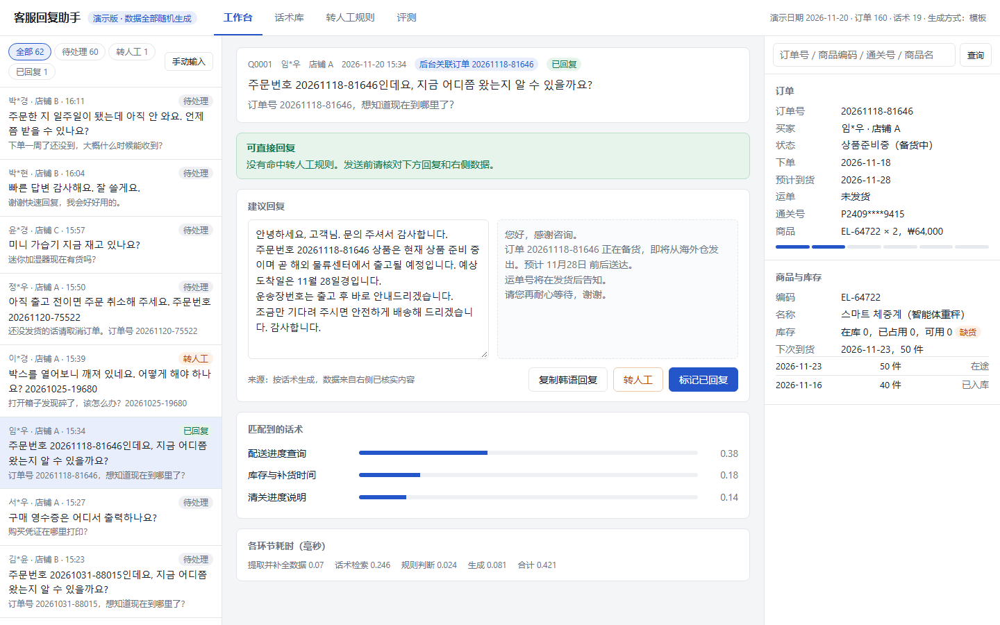

# 客服回复助手（演示版）

给跨境电商客服用的回复工作台：打开一条韩语咨询，系统先把订单、库存、到货数据查出来，再从话术库里找最接近的话术，生成一条韩语敬语回复和中文对照；遇到退货退款、改单、投诉、质量问题这类情形，不直接答复，转给人工。

这是一个演示项目，**代码从零编写，数据全部随机生成**（商品、买家、订单、通关号、运单号、咨询都是脚本造的），不含任何真实公司的代码和数据。



## 回复链路

```
咨询文本
  │
  ├─ 1. 提取硬事实      订单号、商品编码、通关号（正则）
  ├─ 2. 数据补全        订单状态、预计到货、运单、库存、到货计划
  ├─ 3. 话术检索        字符二元组 TF-IDF，取最相近的 3 条
  ├─ 4. 转人工判断      10 条规则，任意一条命中就转人工
  └─ 5. 生成回复        话术模板填入已核实数据；可选接大模型改写
```

几个设计取舍：

- **回复里的状态、日期、数量只来自数据，不来自模型。** 先查数据再生成，模型只负责措辞。
- **缺数据就问，不猜。** 话术需要订单数据而咨询里没有订单号时，回复是“请提供订单号”。
- **转人工有两道网。** 一道是关键词规则，一道是“命中的话术本身属于人工处理类”。任意一道命中，建议回复都换成安抚话术。
- **订单超过预计到货日 3 天仍未签收**，即使买家只是问进度，也转人工去催物流。
- **话术和规则都是数据**，在页面上改，保存后立刻生效，不用改代码。
- **每个环节单独计时**，页面和 `scripts/bench.py` 都能看到耗时花在哪。

## 运行

需要 Python 3.10 以上。

```bash
pip install -r requirements.txt
python -m uvicorn app.main:app --port 8620
```

浏览器打开 http://127.0.0.1:8620 。

```bash
python -m pytest -q             # 30 个测试
python scripts/evaluate.py      # 检索和转人工的命中情况
python scripts/bench.py         # 各环节耗时
python scripts/make_demo_data.py  # 重新生成随机数据（固定种子，结果不变）
```

## 页面

| 页面 | 内容 |
|---|---|
| 工作台 | 左侧咨询列表，中间建议回复（可改、可复制）和匹配到的话术，右侧已核实的订单、库存、到货数据；可按订单号、商品编码、通关号、商品名查询 |
| 话术库 | 新增、编辑、停用话术；每条话术有示例问法、关键词、韩语模板、中文对照、给客服的处理提示 |
| 转人工规则 | 查看每条规则的触发条件，随时开关 |
| 评测 | 用带标签的咨询跑完整链路，列出没命中的咨询 |

## 评测结果

62 条带标签的随机咨询，模板模式：

| 指标 | 结果 |
|---|---|
| 话术检索，第一条就是正确类别 | 95.2% |
| 话术检索，前三条包含正确类别 | 98.4% |
| 转人工召回（该转的 30 条） | 100% |
| 转人工准确（转了 30 条） | 100% |
| 单条咨询全链路耗时 | 不到 1 毫秒（不含模型调用） |

这些数字只说明机制在这批自造数据上按预期工作。咨询是按模板造的，比真实买家的说法规整得多，不能当作真实业务效果。没命中的 3 条在评测页里列着，给对应话术补一条示例问法就能修正，这也是话术库平时的维护方式。

## 接大模型（可选）

默认用模板生成，不联网、结果确定。设置下面的环境变量后，会调用 OpenAI 兼容接口，在话术和已核实数据的基础上改写回复：

```bash
LLM_BASE_URL=http://127.0.0.1:8000/v1
LLM_MODEL=your-model
LLM_API_KEY=            # 没有可不填
```

- 只有“数据齐全且不需要转人工”的回复才会交给模型改写。
- 发给模型的通关号是打码后的。
- 模型调用失败或返回格式不对时，退回模板结果。
- 这部分目前只用桩接口测过（见 `tests/test_chain.py`），没有接真实模型跑过。

## 目录

| 路径 | 内容 |
|---|---|
| `app/facts.py` | 提取订单号等标识并从数据里补全，生成模板可用的字段 |
| `app/retriever.py` | 话术检索 |
| `app/rules.py` | 转人工规则 |
| `app/generator.py` | 模板生成和可选的大模型改写 |
| `app/pipeline.py` | 把各环节串起来并计时 |
| `app/evaluate.py` | 评测 |
| `app/main.py` | HTTP 接口 |
| `web/` | 原生 JS 单页工作台 |
| `scripts/make_demo_data.py` | 随机数据生成，含话术库和规则的初始内容 |
| `demo_data/` | 生成好的随机数据 |
| `tests/` | 测试 |

## 演示版没有做的

- 没有接任何真实电商平台，咨询列表是随机生成的。
- 没有浏览器插件，只有网页工作台。
- 没有数据库，数据在内存里；页面上对话术和规则的修改存在本地 `local/` 目录。
- 检索用的是不需要下载模型的 TF-IDF。要换成向量模型，替换 `app/retriever.py` 里的类即可，接口是 `rebuild(scripts)` 和 `search(text, k)`。
- 话术里的售后政策是为演示假设的。

## 说明

开发方式为 AI 编程（Claude Code），本人负责流程设计、取舍和验收。
